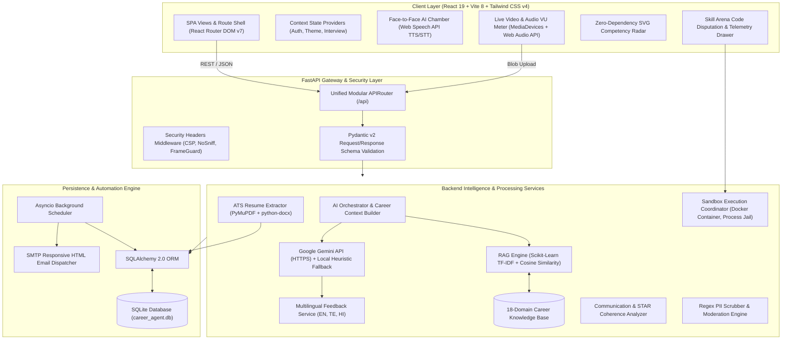

# AI Career Preparation Agent — Full Technology Stack & Implementation Guide

## Executive Overview
The **AI Career Preparation Agent** is an autonomous, full-stack career acceleration platform. It integrates ATS resume parsing, multi-turn generative mock interviews, a 6-axis competency radar, Retrieval-Augmented Generation (RAG) curriculum grounding, secure multi-tier code sandboxing, and proactive habit retention.

This document details every technology, framework, library, and API utilized across both the **Frontend** and **Backend**, including **why** each was selected, **what** role it performs, and **how** it is implemented in the codebase.

---

## Architecture Flow Diagram



---

## 1. Frontend Technology Stack & Libraries

### 1.1 Core Framework & Tooling

| Technology / Library | Version | Role / Purpose | How It Is Implemented |
|---|---|---|---|
| **React** | `^19.2.8` | Core UI library for building component-based Single Page Applications (SPA). | Implements declarative state-driven views using React hooks (`useState`, `useEffect`, `useRef`, `useCallback`, `useContext`, `useMemo`). Code-splitting via `React.lazy` and `Suspense` in `src/App.jsx`. |
| **React DOM** | `^19.2.8` | Renders React component trees into the browser's Document Object Model (DOM). | Mounted in `src/main.jsx` using `createRoot(document.getElementById('root')).render(...)`. |
| **Vite** | `^8.2.2` | High-speed frontend build tool and development server using native ES Modules. | Configured in `vite.config.js`. Provides near-instant Hot Module Replacement (HMR), production bundling, and reverse-proxying `/api` requests to the FastAPI backend (`http://127.0.0.1:8000`). |
| **@vitejs/plugin-react** | `^6.1.0` | Official Vite plugin for React support (Fast Refresh and JSX transformation). | Registered in `vite.config.js` plugins array to transpile JSX/React 19 syntax. |
| **React Router DOM** | `^7.18.3` | Declarative client-side routing and URL management. | Handles 13+ application routes in `src/App.jsx` (e.g. `/dashboard`, `/mock-interview`, `/ats`, `/skill-arena`, `/career-journey`). Protects authenticated routes via `src/components/ProtectedRoute.jsx`. |
| **Tailwind CSS** | `^4.3.3` | Utility-first CSS styling engine. | Integrated with `@tailwindcss/vite` in `vite.config.js` and imported via `@import "tailwindcss";` in `src/index.css`. Powers modern glassmorphism, responsive grid layouts, and color themes. |
| **Lucide React** | `^1.43.0` | Modern, tree-shakeable SVG icon collection. | Supplies clear, uniform icons throughout the application (e.g., `Camera`, `Mic`, `Send`, `Clock`, `Sparkles`, `Code2`, `Shield`, `Award`) in `src/components/Navbar.jsx`, `src/components/Sidebar.jsx`, and `src/pages/MockInterviewPage.jsx`. |
| **Oxlint** | `^1.79.0` | High-speed Rust-based JavaScript/JSX linter. | Configured via `.oxlintrc.json` and run through `npm run lint` for code quality checks. |

---

### 1.2 Browser Web APIs (Native Technologies)

| Browser API | Purpose | How It Is Implemented |
|---|---|---|
| **Web Speech API (`speechSynthesis`)** | Text-to-Speech (TTS) engine enabling AI interviewers to speak questions aloud. | Orchestrated in `src/hooks/useFaceToFaceDialogue.js`. Filters system voices by language (`en`, `te`, `hi`, `es`) and interviewer persona gender, strips code blocks/markdown before verbalization, and coordinates turn-taking callbacks. |
| **Web Speech Recognition API (`SpeechRecognition` / `webkitSpeechRecognition`)** | Real-time continuous Speech-to-Text (STT) for candidate verbal responses. | Implemented in `src/pages/MockInterviewPage.jsx`. Continuously transcribes spoken answers into textual input while preserving natural conversational pauses and filler words. |
| **MediaStream Recording API (`getUserMedia` & `MediaRecorder`)** | Captures camera and microphone streams and records audio/video interview answers. | Handled in `src/components/video/CameraPreview.jsx` and `src/pages/MockInterviewPage.jsx`. Requests 720p/1080p video with echo cancellation and noise suppression, buffers media chunks, and constructs downloadable `webm`/`mp4` blobs. |
| **Web Audio API (`AudioContext`, `AnalyserNode`)** | Real-time audio waveform processing and microphone volume meter. | Built in `src/components/video/CameraPreview.jsx`. Analyzes raw microphone frequencies via `analyser.getByteFrequencyData()`, calculates root-mean-square amplitude, and renders dynamic visual volume meters. |
| **Web Storage API (`localStorage`)** | Client-side persistent cache for session tokens, candidate profiles, and offline telemetry. | Abstracted in `src/utils/storage/storageService.js`. Manages fallback career states, user credentials, active themes, and cached interview history. |

---

### 1.3 Custom Data Visualizations (Zero-Dependency SVG)

Instead of relying on heavy third-party charting libraries, the application uses custom-engineered, lightweight SVG components:
- **6-Axis Competency Radar (`src/components/RadarChart.jsx`)**: Calculates geometric coordinates $(x = r \cdot \cos(\theta), y = r \cdot \sin(\theta))$ across 6 competency dimensions (*Technical Knowledge*, *Problem Solving*, *Communication*, *Confidence*, *Relevance*, *System Design*).
- **Circular Score Meters (`src/components/CircularScore.jsx`)**: Uses SVG `strokeDasharray` and `strokeDashoffset` to animate radial percentage scores for ATS matches and interview feedback.
- **Performance Progress Trackers (`src/components/PerformanceChart.jsx`, `src/components/ProgressBar.jsx`)**: Responsive SVG vectors for score trends and streak histories.

---

## 2. Backend Technology Stack & Libraries

### 2.1 Core Framework, API & Runtime

| Technology / Library | Version | Role / Purpose | How It Is Implemented |
|---|---|---|---|
| **Python** | `3.10+` | Core programming language powering the server, data models, AI logic, and tests. | Implements asynchronous coroutines, type hinting, abstract base classes, and file processing pipelines. |
| **FastAPI** | `>=0.110.0` | High-throughput asynchronous ASGI web framework. | Configured in `backend/app/main.py`. Manages application lifespan, mounts modular domain routers via `backend/app/api/router.py`, generates automated Swagger/OpenAPI documentation (`/docs`), and enforces HTTP security headers. |
| **Uvicorn** | `>=0.28.0` | Asynchronous Server Gateway Interface (ASGI) web server. | Serves the FastAPI application on `0.0.0.0:8000` with uvloop-level asynchronous I/O and hot-reloading. |
| **Python-Multipart** | `>=0.0.9` | Streaming multipart/form-data request parser. | Enables secure handling of binary resume file uploads (PDF, DOCX) in `backend/app/api/resume.py` and media recordings. |
| **Pydantic v2** | `>=2.6.0` | Data parsing, type validation, and settings management. | Encapsulates all domain request/response contracts in `backend/app/schemas/` (e.g., `AskAIRequest`, `ExecutionJob`, `InterviewSessionResponse`). Manages global configurations in `backend/app/core/config.py`. |

---

### 2.2 Database & Data Persistence

| Technology / Library | Version | Role / Purpose | How It Is Implemented |
|---|---|---|---|
| **SQLAlchemy** | `>=2.0.0` | Enterprise-grade Object-Relational Mapping (ORM) and SQL toolkit. | Declares 20+ relational data models in `backend/app/db/models.py` (Users, Profiles, Activities, Interviews, SkillGaps, Challenges, Achievements, WeeklyReports, etc.). Manages session scoping and thread-safe dependency injection (`get_db`) in `backend/app/db/database.py`. |
| **SQLite** | `3.x` | Embedded relational database engine. | Persisted in `backend/career_agent.db`. Provides zero-configuration ACID-compliant local storage with indexed queries and cascading foreign keys. |

---

### 2.3 Machine Learning, RAG & Vectorization

| Technology / Library | Version | Role / Purpose | How It Is Implemented |
|---|---|---|---|
| **Scikit-Learn** | `>=1.3.0` | Machine learning toolkit providing TF-IDF vectorization. | Powers the local RAG vectorizer in `backend/app/services/ai/rag/embedding_service.py`. Fits an n-gram `TfidfVectorizer` (unigrams + bigrams) across 18 curated curriculum domains to convert text queries into dense normalized vectors with sub-millisecond latency and zero API cost. |
| **NumPy** | `>=1.24.0` | Numerical computing and multidimensional array math. | Computes vector norms (`np.linalg.norm`), dot products, and cosine similarity matrices in `backend/app/services/ai/rag/embedding_service.py` and `backend/app/services/ai/rag/retrieval_service.py`. |

---

### 2.4 Document Processing & Text Extraction

| Technology / Library | Version | Role / Purpose | How It Is Implemented |
|---|---|---|---|
| **PyMuPDF (`fitz`)** | `>=1.24.0` | High-performance C-based PDF document extractor. | Inspects PDF byte signatures (`%PDF`), extracts UTF-8 text streams from each page in memory, normalizes ligatures and typography, and detects non-extractable scanned image PDFs in `backend/app/services/resume_extractor.py`. |
| **Python-Docx** | `>=1.1.0` | Parser for Microsoft Word (`.docx`) XML documents. | Unpacks document ZIP archives in memory, parses XML DOM elements, and extracts paragraph text and table cell data in `backend/app/services/resume_extractor.py`. |

---

### 2.5 AI Models, Multilingual Translation & Heuristics

| Component | Technology | Purpose | How It Is Implemented |
|---|---|---|---|
| **Google Gemini API** | HTTPS REST / JSON (`gemini-1.5-flash` / `gemini-2.0-flash`) | Production cloud LLM for dynamic question generation, 5-axis response scoring, and RAG answer synthesis. | Built in `backend/app/services/ai/llm/gemini_service.py` using native Python `urllib.request`. Features JSON mode enforcement, configurable temperature/top-p, and graceful local fallback when keys are absent. |
| **Local Grounded LLM** | Deterministic Heuristic Engine (`LocalGroundedLLMService`) | Zero-cost, 100% offline fallback inference engine. | Implemented in `backend/app/services/ai/llm/llm_service.py`. Uses canonical curriculum references, regex term matching, and STAR framework heuristics to generate grounded interview feedback. |
| **Multilingual Localizer** | Multilingual Feedback Service | Delivers personalized interview evaluations in English, Telugu (తెలుగు), and Hindi (हिन्दी). | Built in `backend/app/services/ai/llm/multilingual_feedback_service.py`. Automatically preserves critical technical terminology (e.g. *Docker*, *Transformer*, *Latency*, *STAR method*) in English while translating explanatory guidance. |
| **Curated Knowledge Base** | Domain Curriculum (`knowledge_base.py`) | 18 specialized technical curriculum modules. | Stores verified questions, core concepts, and anti-patterns for Machine Learning, System Design, Python Internals, MLOps, SQL, and Behavioral competencies in `backend/app/services/ai/rag/knowledge_base.py`. |

---

### 2.6 Multi-Tier Code Execution Sandbox

| Isolation Layer | Backend Technology | Security & Resource Controls | How It Is Implemented |
|---|---|---|---|
| **Tier 1: Container Sandbox** | Docker (`DockerSandboxExecutor`) | `--read-only` root filesystem, `--network none`, dropped Linux capabilities (`--cap-drop ALL`), unprivileged UID (`1000:1000`), 256MB memory cap. | Executed via CLI invocation in `backend/app/services/sandbox/docker_executor.py`. |
| **Tier 2: Process Jail Sandbox** | Subprocess Jail (`ProcessSandboxExecutor`) | Ephemeral temporary directory sandbox, strict environment secret scrubbing (`GEMINI_API_KEY`, `DATABASE_URL` scrubbed), 3-second hard timeout kill, and standard stream capture. | Implemented in `backend/app/services/sandbox/process_executor.py`. |
| **Sandbox Manager** | Coordinator (`SandboxManager`) | Selects highest available execution tier (Docker $\rightarrow$ Process) and grades hidden unit tests. | Coordinated in `backend/app/services/sandbox/sandbox_manager.py`. Untrusted code is never run via server-side `eval()` or `exec()`. |

---

### 2.7 Background Scheduling & Email Dispatching

| Component | Library / Module | Purpose | How It Is Implemented |
|---|---|---|---|
| **Proactive Background Scheduler** | Python `asyncio` Task Loop | Asynchronous periodic worker evaluating candidate practice velocity. | Created in `backend/app/services/scheduler.py` and started during FastAPI startup in `backend/app/main.py`. Runs every 60 seconds to identify candidates with pending practice streaks and trigger personalized reminder notifications. |
| **Email Notification Dispatcher** | `smtplib` & `email.mime` | Formats and sends high-impact, branded HTML reminder emails. | Implemented in `backend/app/services/email_service.py`. Supports dual modes: `development` (safe console preview) and `smtp` (production TLS/SSL delivery via Gmail/SendGrid). |
| **Deterministic PII Sanitizer** | Regular Expressions (`re`) | Scans and redacts sensitive personally identifiable information. | Built in `backend/app/services/pii_detection_service.py`. Pre-scans community interview experience submissions to strip phone numbers, email addresses, bearer tokens, and credentials before database insertion. |

---

## 3. Testing & Quality Verification Suite

| Test Module | Framework | What It Validates |
|---|---|---|
| `tests/test_secure_sandbox.py` | `unittest`, `FastAPI TestClient` | Subprocess jail isolation, hard 3-second timeouts, secret environment scrubbing, and hidden test-case validation. |
| `tests/test_generative_interview_engine.py` | `pytest`, `unittest` | 16-scenario suite verifying question synthesis, 5-axis evaluations, anti-repetition memory, adaptive difficulty scaling, and closed-loop XP sync. |
| `tests/test_phase16_multilingual.py` | `pytest` | Multilingual localization across Telugu, Hindi, and English with strict English technical term preservation. |
| `tests/test_phase17_experiences.py` | `pytest` | PII regex detection, community experience moderation workflows, and knowledge base integration. |
| `tests/test_phase18_career_journey.py` | `pytest` | 14-milestone career lifecycle progression, readiness band calculations, and automated status transitions. |
| `tests/test_phases_19_to_22.py` | `pytest` | Weekly AI summary report generation, weekly goal tracking, 30-day streak recovery allowances, and security probes. |
| `tests/test_real_llm_and_role_sync.py` | `pytest` | Gemini API live client connectivity, prompt structuring, and profile target-role synchronization. |

---

## 4. Summary Matrix: Technology to Feature Mapping

```
                                      AI CAREER PREPARATION AGENT
  ┌────────────────────────────────────────────────┬────────────────────────────────────────────────┐
  │ FRONTEND LAYER                                 │ BACKEND LAYER                                  │
  ├────────────────────────────────────────────────┼────────────────────────────────────────────────┤
  │ React 19 + Vite 8                              │ FastAPI + Uvicorn                              │
  │ • Component-based SPA architecture             │ • High-performance asynchronous REST API       │
  │ • Instant Hot Module Replacement (HMR)         │ • Automated OpenAPI / Swagger documentation    │
  │                                                │                                                │
  │ React Router DOM v7                            │ Pydantic v2                                    │
  │ • 13+ client routes, protected navigation      │ • Strict data parsing and schema validation    │
  │                                                │                                                │
  │ Tailwind CSS v4 + Lucide React                 │ SQLAlchemy 2.0 + SQLite                        │
  │ • Glassmorphic cards, dynamic color palettes   │ • 20+ relational tables with foreign keys      │
  │ • Accessible, tree-shakeable SVG icons         │ • ACID-compliant local database storage        │
  │                                                │                                                │
  │ Web Speech API (TTS & STT)                     │ Google Gemini API + Local Heuristic Fallback   │
  │ • Voice persona synthesis (Julian, Elena...)   │ • Multi-turn generative interview synthesis   │
  │ • Real-time verbal answer transcription        │ • 5-axis scoring (Accuracy, STAR, Depth...)    │
  │                                                │                                                │
  │ MediaStream & Web Audio API                    │ Scikit-Learn + NumPy (RAG)                     │
  │ • Webcam preview, video chunk recording        │ • Sub-millisecond TF-IDF vectorization         │
  │ • Real-time microphone VU audio meter          │ • Grounded 18-domain curriculum retrieval      │
  │                                                │                                                │
  │ Custom Zero-Dependency SVG Visualizations      │ PyMuPDF + Python-Docx                          │
  │ • 6-axis competency radar charts               │ • In-memory PDF and DOCX text extraction       │
  │ • Circular score rings and progress meters     │ • Scanned image detection and normalization    │
  │                                                │                                                │
  │ Client-Side State & Storage                    │ Multi-Tier Sandbox (Docker / Process Jail)     │
  │ • Context API (Auth, Interview, Theme)         │ • Memory limits (256MB), hard timeouts (3s)    │
  │ • LocalStorage fallback caching                │ • Secret scrubbing; Zero server-side exec()    │
  │                                                │                                                │
  │                                                │ Asyncio Scheduler + SMTP Email Service         │
  │                                                │ • Proactive habit retention background loop    │
  │                                                │ • Branded HTML notification delivery           │
  └────────────────────────────────────────────────┴────────────────────────────────────────────────┘
```
